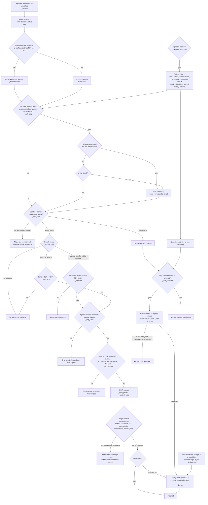

# ODD+D description of the SF APS request-channel model

This document describes the agent-based model following the ODD protocol, second update (Grimm et al., 2020), extended with the ODD+D elements for human decision-making (Müller et al., 2013). It is written so that the model can be reimplemented without reading the code. Where wording and code could diverge, the code governs: every rule below cites the function in `code/model.py` that implements it (line numbers refer to the version in this package). Parameter names are the code names used in `code/params.py`; their ranges, defaults and source categories are listed in `docs/parameters.md` and `data/parameters.csv`. Input files are described in `docs/data-dictionary.md`. This document is the model's design specification and describes the code exactly. The development and testing history of the model, including corrections made before the final runs, is reported in `docs/TRACE.md` (§5.6 for corrections found while this description was checked against the code).

The document describes how the model works. It reports no experimental results; those are in `docs/results.md`.

Notation. Month indices are integers counted from January 2020: `mi("YYYY-MM") = (YYYY − 2020)·12 + MM − 1` (`mi`, l.33). "July" means month index ≡ 6 (mod 12). An annual rate λ is converted to a monthly probability as 1 − exp(−λ/12) unless stated otherwise. U is a uniform draw on [0, 1) from the run's single random-number generator. `round(·)` is Python's rounding (ties to even); `int(·)` truncates toward zero.

### Glossary

| Term | Meaning in this document |
|---|---|
| APS | Accessible pedestrian signal: push-button unit with audible and vibrotactile walk indications. |
| Request list | SFMTA's published list of crossings for which APS has been requested, with each crossing's status (SFMTA, 2020–2026). |
| Candidate (C) | A requested crossing that can take APS on its existing signal hardware and is waiting only for money. |
| Funding-needed (N) | A requested crossing that needs a full signal upgrade (new poles, conduit, ramps) before APS can be installed. |
| Funded agency-crew (Fi) | Funded and waiting for SFMTA's own Signal Shop crews to install. Funded crossings can wait in this state without a deadline when crew capacity is short. |
| Funded signal-project (Fs) | APS included in a separately funded signal project and delivered with it. |
| HSIP-funded (Fh) | Inside an awarded HSIP project that has not yet reached construction. |
| Owner | A named staff member responsible for turning the request list into funding applications (`owner()` = 1). |
| HSIP | Highway Safety Improvement Program: the federal safety programme administered in California by Caltrans in biennial application cycles (Caltrans, 2026c). It does not fund APS alone; APS must ride on safety measures that reduce crashes. |
| Carrier | A crash-reducing safety measure that an HSIP application can contain and to which APS is attached as accompanying work (for example 12-inch signal heads, backplates, mast arms, countdown heads, leading pedestrian intervals). |
| BCR | Benefit–cost ratio: estimated crash-cost savings over the measures' service life divided by project cost. HSIP requires at least 5.0 to apply; Caltrans funds applications down to a cycle-specific cutoff (`c_final`). |
| KA, B, C | Crash severities on the KABCO scale: killed or severe injury, other visible injury, possible injury. Property-damage-only crashes (O) are not in the data. |
| Set-aside | A separate HSIP pot for pedestrian-crossing projects that is awarded without a BCR test, with a $400,000 project limit (90% federal) and at most 20% of cost for work outside the eligible list, such as APS (Caltrans, 2026c). |
| Bundle mode | How an HSIP application is assembled: `as_planned` (the existing APS capital-plan project submitted as written, APS only, hence ineligible), `sg015` (APS added to the signal-visibility project on the SG015 corridors), `repack` (APS added to carriers at any candidate or funding-needed crossing, split into separate packages, plus a set-aside). |
| SG015, SG017, SG105, SG142 | SFMTA capital-plan line items: SG015 signal-visibility upgrades on five named corridors; SG017 traffic-signal hardware replacement funded by Prop L; SG105 the former dedicated APS line (funded until its money ran out, date undocumented); SG142 the planned APS project (SFMTA, 2022b; SFMTA, 2026c). |
| Prop L | San Francisco's half-cent transportation sales tax, programmed by SFCTA (SFCTA, 2022). A Prop L amendment adds or changes a programme line and needs a vote of the SFCTA Board, which can reject (veto) or defer it. |
| Standing local line | A recurring annual budget amount for APS from local sources (a Prop L line or a General Fund line), allocated every July without a separate application. |
| General Fund line | A standing local line obtained through the City's annual General Fund budget. |
| Director reallocation | A one-time reallocation of SFMTA capital funds to APS by the Director; hypothetical, with no documentary support for an amount (SFMTA Board of Directors, 2026). |
| PE, CON, E-76 | Preliminary engineering (design) and construction phases of a federally funded project; E-76 is the federal authorization to proceed with a phase. |
| PIF | Public interest finding: required before an agency's own crews may build federally funded work; if denied, the work is contracted out at higher cost (Caltrans, 2026e). |
| Red flag | Caltrans's marker for a project that missed a delivery milestone; it makes the agency ineligible at later reviews until cleared (Caltrans, 2026c). |
| LRSP | Local road safety plan; HSIP applicants need a plan updated or confirmed within five years (Caltrans, 2026c). |
| Contingency, top-up | Contingency is the reserve budgeted on top of planned cost (`k_cont`); a top-up is an additional allocation requested when costs exceed planned cost plus contingency. |
| Deflection | Buck-passing: staff answer advocacy pressure by pointing to another body (SFCTA, the General Fund or Caltrans) or to cost, and the pressure leaves no effect (SFMTA staff, personal communication, 2026; SFMTA, 2026a). |
| Fold-in status | For crossings assigned to an existing project: `yes` (in scope), `likely` and `unverified` (in scope with probability `pi_scope`), `no_parent_done` (the parent project finished without APS), `no_unfunded` (the parent project is unfunded). |
| Signpost | An observable event or elapsed time that triggers a pathway switch (Haasnoot et al., 2013). |
| Failure event | Any logged setback, including events that are not application rejections, such as an owner leaving (F-h) or advocacy falling quiet (F-m); see §8.18. |

---

## 1. Purpose and patterns

### 1.1 Purpose

The model explores under which conditions San Francisco's accessible pedestrian signal (APS) request channel turns pending requests into funded and installed crossings, and how seven pathways for changing the funding and coordination arrangements compare when delays, refusals and delivery failures occur. Specifically it supports three questions:

1. Which of six alternative settings (mechanisms) for the observed stall can reproduce the 2022–2026 request-list stocks, and with which parameter values.
2. Under which combinations of conditions money flows to the request channel within five years.
3. Which pathway outperforms current practice across more of the sampled uncertainty space.

The seven pathways, in brief (rules in §8.12):

| Pathway | First action | Switches if it stalls |
|---|---|---|
| PW0 current practice | none; staff start applications only at the baseline probability | none |
| PW1 HSIP-first (federal safety-grant first) | bundle APS with signal-visibility upgrades on SG015 corridors for HSIP Cycle 13 | wider HSIP bundle in Cycle 14 if Cycle 13 brings no award or an award covering fewer than two crossings; then a Prop L amendment; if that fails, a one-time Director reallocation with probability `q_dir` |
| PW2 local-first | Prop L amendment restoring an APS line | General Fund line request; then an HSIP bundle |
| PW3 accountability-first | named owner, written deadline, more oversight, more advocacy | structured negotiation; then a lawsuit (in the model both raise only the start probability; this is a simplification, not a finding that legal action cannot compel installation) |
| PW4 crossing-specific allocation | each crossing gets a route: existing projects, corridor designs, HSIP bundle, standing local line | crossings whose parent project is late move to the local queue |
| PW5 design standards | APS added whenever push-button or signal hardware is replaced, within an annual budget | standing local line after two years if too few installs |
| PW6 existing hardware programme | include new APS in SG017 hardware-replacement allocations | Prop L amendment; General Fund; HSIP bundle |

Each pathway runs under six settings (mechanisms), alternative explanations of the observed stall (§8.2): M-A unassigned responsibility; M-B1 staffing constraint from 2024; M-B2 staffing constraint from 2023; M-C1 rising costs; M-C2 technical constraints; M-D combined.

The model is a scenario-exploration tool under stated rules. It is not a forecast: its rules are assembled from public documents and an interview (SFMTA staff, personal communication, 2026), and most behavioural parameters and all venue-outcome probabilities (for example `q_veto`, `q_gf`, `q_dir`, `p_sa`, `q_fail`, `rho_flag`) are explored over ranges rather than estimated. They are not estimates of how SFCTA, the City budget or Caltrans actually behave. Reproducing the historical pattern shows that a setting is consistent with the data, not that its mechanism operated. Mechanism comparisons are supporting evidence for attribution, not proof of cause. Shares reported from the experiments are shares of a designed sample of assumptions, not probabilities of real-world events.

### 1.2 Patterns used for evaluation

The patterns are the five stocks of the SFMTA APS request list at nine published snapshots (SFMTA, 2020–2026; input `history.observed_stocks`, see `docs/data-dictionary.md`). Stocks are counts of crossings by state: candidate (C), funding-needed (N), funded agency-crew (Fi), funded signal-project (Fs), and the cumulative installed count within the list (I).

| Snapshot | C | N | Fi | Fs | I |
|---|---|---|---|---|---|
| 2022-07-29 (initial state) | 8 | 17 | 22 | 27 | 30 |
| 2023-01-03 | 8 | 18 | 19 | 23 | 39 |
| 2023-06-30 | 10 | 18 | 15 | 22 | 45 |
| 2024-02-20 | 26 | 18 | 4 | 22 | 56 |
| 2024-08-21 | 26 | 19 | 1 | 19 | 62 |
| 2025-02-21 | 28 | 19 | 1 | 20 | 62 |
| 2025-08-08 | 32 | 20 | 1 | 21 | 62 |
| 2026-01-29 | 38 | 19 | 1 | 17 | 67 |
| 2026-06-30 | 35 | 18 | 2 | 21 | 69 |

Qualitatively the patterns are: the agency-crew stock drains from 22 to 1 by August 2024 with no new batch afterwards; candidates accumulate from 8 to about 28 by February 2025; funding-needed crossings stay at 17–20; signal-project crossings stay at about 19–23 while cumulative installations rise from 30 to 62 by February 2025.

Use of the patterns:

- **Screening (calibration).** The 2022-07-29 snapshot is the initial state. A parameter combination is accepted when, for the mean over 20 replicates, the absolute difference from the observed value is within the tolerance for every stock at each of the five snapshots from 2023-01-03 to 2025-02-21. Tolerances: C ±6, N ±4, Fi ±5, Fs ±6, I ±8 (`code/experiments.py`, `FIT_SNAPS`, `TOL`, `fits`). Screening is reported as calibration, not validation.
- **Retrospective time check.** Accepted combinations are scored against the three later snapshots (2025-08-08, 2026-01-29, 2026-06-30) with the same tolerances (`H1_SNAPS`). These snapshots were not used for screening, but the shape of the 2023–2026 lists was known when the rules were designed, so this check is not independent validation.
- **Independent validation** is possible only with data published after the design was fixed (the next SFMTA request list; whether the existing APS capital-plan project restarts; whether an SF APS bundle appears in the next HSIP award list). These are not part of the package.

Model-generated stocks are read at the end of the month that contains the snapshot date (`run`, `_summary`, key `snapshot_stocks`). The start month is itself a simulated step: the 2022-07-29 list is the initial state, and the model's 2022-07 stocks are recorded after one month of dynamics.

---

## 2. Entities, state variables and scales

The model has four kinds of entity: crossings (the request-list sites), application tasks, HSIP application instances and HSIP projects. One decision-making agent (A2) and a set of rule-following actors and venues act on them. Global state variables belong to the simulation object `Sim` (`__init__`, l.61–99).

### 2.1 Actors

| Code | Actor | Role in the model | Behaviour type |
|---|---|---|---|
| A2 | SFMTA capital-budget and grant staff | Decides each month whether to start preparing an application for each venue (§8.3). The only agent with a decision rule. | Stochastic decision rule |
| A1 | SFMTA APS engineering staff | Classifies arriving requests (state, rank). | Random classification at fixed shares |
| A3 | Signal Shop (in-house crews) | Installs funded agency-crew crossings within accumulated capacity (§8.17). | Fixed rule with capacity |
| C2 | Advocacy groups, with the Mayor's Disability Council as a channel | Generate pressure events; can fall quiet (§8.2). | Stochastic event process |
| C3 | Residents requesting APS | Generate new requests (§8.1). | Stochastic arrival process |
| D1 | External enforcement | An enforcement level 0–4 that enters the start decision only (§8.2). | Stochastic step process; set by pathway PW3 |
| CT | Caltrans (HSIP administrator) | Eligibility review, award, delivery milestones (§8.7–8.11). | Rule engine |
| SFCTA | San Francisco County Transportation Authority | Prop L amendments, SG017 allocations, top-up allocations. | Rule engine with probabilities |
| GF | City General Fund budget | Annual General Fund requests. | Rule engine with probabilities |
| DIR | SFMTA Director | One-time reallocation (PW1 only). | Probability |
| PARENT | Signal projects that carry APS | Deliver funded signal-project crossings; corridor scope additions. | Hazard rate |

The actor codes appear in the event stream (`ev`, l.211) and are given here so that event output can be read.

### 2.2 Crossings (sites)

Each crossing is a record created by `_site` (l.106) and, in the projection segment, completed by `_init_sites` (l.118), `_draw_carriers` (l.162) and `_arrivals` (l.335).

| Attribute | Type | Values | Initial value / how set |
|---|---|---|---|
| `key` | string | site identifier | from input; arrivals `new-{month}-{index}` |
| `state` | categorical | `C` candidate; `N` funding-needed (requires a full signal upgrade); `Fi` funded agency-crew; `Fs` funded signal-project; `Fh` funded through an HSIP project; `I` installed | from input, then modified at initialization (§6) |
| `rank` | categorical | `high`, `medium`, `low`, or empty (treated as `medium` when sorting) | from input |
| `installed` | int or None | month index of installation | None; set by `move(s, 'I')`, or t0 − 1 for crossings already installed at the start (§6.2) |
| `listed` | int or None | arrival month | None for initial sites |
| `route` | categorical | `fold` (folded into an existing project), `corridor` (capital corridor candidate), `unidentified` | from input; arrivals and history sites `unidentified` |
| `fold` | categorical or None | `yes`, `likely`, `unverified`, `no_parent_done`, `no_unfunded`, None | from input |
| `sg015` | bool | on one of the five named corridors of capital project SG015 | from input (`sg015_corridor`); absent for arrivals |
| `missing_ped` | bool | known to lack pedestrian countdown heads | from input (`missing_ped_heads`) |
| `crashes` | dict or None | 12 counts: `{pb,nonpb}_{KA,B,C}_{w3,w5}` | from input if matched; otherwise `_impute` (§8.6) |
| `hazard_fs` | bool | whether an Fs crossing can be delivered by its signal project | True; set False by rules in §6.2 |
| `blocked` | bool | technically not installable at all (settings M-C2, M-D) | `switch block and state == 'C' and U < tau`, drawn once at creation from the state passed to `_site` (for pending crossings, the input state before the fold rules of §6.2); crossings that become C later are never blocked |
| `adders` | float (USD) | known extra work: +200,000 if conduit work (`U < q_pipe`), +200,000 if new curb ramps (`U < q_ramp`) | drawn at creation, fixed thereafter |
| `c12`, `cbp`, `clpi`, `cmast` | bool | 12-inch head upgrade possible; backplates possible; new leading pedestrian interval possible; pedestal-mounted (mast-arm conversion possible) | Bernoulli(`s_12in_C`), (`s_bp`), (`s_lpi`), (`s_mast`); projection only |
| `ccd` | bool | new countdown heads are an eligible measure | `missing_ped` or Bernoulli(`s_cd`); projection only |
| `parent_nominal` | int | nominal finish month of the parent project (fold sites) | from `parent_finish`, else t0 + 18 for `likely`/`unverified`/`yes` |
| `parent_ready` | int | earliest delivery month for a corridor-design scope addition (PW4) | t0 + `int(t_parent)` |
| `via` | categorical | `local`, `hsip`, `design_rule`, `corridor_design`, None | funding route that moved the site |
| `ready_at` | int | month from which a Fi site may be installed | award month + `round(t_des)` (local); month of hand-off (HSIP); month of funding (design rule); absent = −1, so crossings that are Fi at initialization can be installed from the first month |
| `in_app` | bool | currently inside a submitted HSIP application | set at submission, cleared at review failure or approval decision |
| `proj` | int | index of the HSIP project holding the site | set at award |
| `pre_fh` | categorical | state before entering `Fh` | set at award |
| `_cms` | set | countermeasure codes used in the latest benefit calculation | set by `_site_bcr_parts` |

Legal state transitions (all through `move`, l.219, which asserts that a site is installed only once, that a Fi site is not installed before `ready_at`, and that a terminated project delivers nothing):

| From | To | Submodel |
|---|---|---|
| C | Fi | local batch award (§8.4); design rule (§8.15) |
| C, N | Fh | HSIP award (§8.9) |
| C, N | Fs | PW4 corridor scope addition (§6.2); historical exogenous scope additions (§8.17) |
| Fs | C | PW4 parent-delay reroute (§8.12) |
| Fs | I | signal-project delivery (§8.17) |
| Fi | I | agency-crew installation (§8.17) |
| Fi | C | local overrun without top-up (§8.16) |
| Fh | Fi | HSIP construction authorized, in-house (§8.11) |
| Fh | I | HSIP construction finished by contractor (§8.11) |
| Fh, Fi | prior state or C | HSIP project termination (§8.11) |

### 2.3 Application tasks

There are two tasks, one per venue: `LOCAL` (Prop L / General Fund annual window) and `HSIP` (`_task`, l.103).

| Attribute | Values | Initial |
|---|---|---|
| `state` | `IDLE`, `PREPARING` | `IDLE` |
| `ready` | month the preparation is complete: start month + `round(d_prep)` | None |
| `started` | month preparation started | absent |
| `deflect_until` | month before which the task cannot start after a deflection | −1 |
| `commit` | None or (cycle, bundle mode): a pathway commitment to prepare for a named HSIP cycle with mode `sg015` or `repack` | None, set by pathways |

### 2.4 HSIP application instances

Created by `_submit_hsip` (l.523) and `_setaside` (l.556); stored in `Sim.apps`.

| Attribute | Meaning |
|---|---|
| `cycle` | HSIP cycle name (`C13`–`C17`) |
| `sites` | crossings in the application |
| `bcr` | benefit–cost ratio of the bundle (None for the set-aside) |
| `cost` | total cost including contingency (set-aside: summed component cost) |
| `aps_extra` | APS cost not in existing capital plans (reported only) |
| `mode` | `sg015`, `repack` or `setaside` |
| `review` | November of the cycle year |
| `approve` | March or April of the following year (set-aside: April) |
| `reviewed` | flag |

### 2.5 HSIP projects

Created by `_new_project` (l.665); stored in `Sim.projects`.

| Attribute | Meaning |
|---|---|
| `cs` | cycle start: January of the year after the award |
| `des_at` | design-complete month (overrun discovered) |
| `con_at` | construction authorization month (CON E-76) |
| `contract` | public-interest finding denied, so the work is contracted out |
| `build_at` | month of hand-off (in-house) or completion (contractor) |
| `limit` | construction-authorization milestone in months: 36, or 42 with consultant design (`sw_consult`) |
| `cancel` | partner project will be cancelled (SG015 bundles only) |
| `flag_from`, `flag_to` | red-flag window |
| `ext_end` | end of the single five-year extension |
| `end_at` | month of termination (terminated projects only) |
| `gap_retry` | month of the second request to fund a contracting gap |
| `cost`, `mode`, `sites`, `done`, `terminated` | as named |

### 2.6 Global state variables

| Variable | Meaning | Initial value |
|---|---|---|
| `now`, `t0`, `T` | current month, start month, horizon | `t0 = mi(start)`; `T` = 120 (projection) or 48 (historical screening) |
| `history` | True if the run starts at or before 2022-07 | from `start` |
| `enf` | enforcement level: 0 none, 1 unknown shadow, 2 structured negotiation, 3 lawsuit, 4 order | 1 |
| `specified` | written deadline (0/1) | 0 |
| `oversight` | actual oversight strength, 0–1 | parameter `oversight` |
| `lam_press` | advocacy pressure event rate (per year) | parameter `lam_press` |
| `press` | months of pressure events that were not deflected | empty |
| `quiet_until` | advocacy suppressed until this month | −1 |
| `vacant_until` | owner post vacant until this month | −1 |
| `p_owner_forced` | named owner imposed (PW3) | absent (False) |
| `line_on` | a standing local line funds APS every July | `sw_line` and not history |
| `line_amount` | annual APS amount of a standing local line: `a_line · aps_share` | computed once |
| `one_time` | one-off money added to the next local decision | 0 |
| `local_submitted` | a local request is waiting for the July decision | False |
| `pending_propl` | (decision month, outcome) of a Prop L amendment | absent |
| `gf_try` | month of a scheduled General Fund decision | absent |
| `pw_state` | pathway node number and month the node was entered | node 0, `t_node = t0` |
| `nodes` | labels of pathway nodes reached | `['{PW}:start']` (projection) |
| `last_submit` | last month a task submitted at a deadline | `t0` |
| `bank` | accumulated in-house crew capacity (sites) | 0 |
| `fund_months`, `hsip_awards`, `fail_months` | months of funding events (request-channel batch awards), HSIP awards, failure events | empty |
| `rule_months` | months of design-rule add-ons (PW5); not funding events | empty |
| `hsip_sites_awarded` | crossings in HSIP awards since t0 (PW1 signpost) | 0 |
| `_rho_month`, `_rho_value` | month and outcome of the current review's red-flag draw | absent |
| `overrun_checks` | pending local overrun checks (month, site, planned cost, payer) | empty |
| `cost` | money by payer: `SFMTA`, `SFCTA`, `Caltrans/HSIP`, `refunds` (and `aps_extra_budget`) | zeros |
| `rule_installs` | installs of sites funded by the design rule | 0 |
| `design_rule`, `hw_budget` | PW5 rule active; remaining annual add-on budget | PW5 only |
| `sg017_try` | months of SG017 allocation requests (PW6) | PW6 only |
| `lrsp_until`, `lrsp_upd` | local road safety plan validity and pending update | set at first use |
| `i_base` | installed count at the start of the historical segment (30) | history only; 0 in projection |
| `line_app` | state of the approval variant | variant only |

### 2.7 Venues (rule engines)

- **HSIP** (Highway Safety Improvement Program): biennial cycles `C13`–`C17` in 2026, 2028, 2030, 2032 and 2034 (`HSIP_CYCLES`, l.29). Not available in the historical segment.
- **Local annual window** (Prop L Expenditure Plan line and General Fund): preparation January–June, decision in July (`window`, l.275; `_local_decision`, l.391).
- **Prop L amendment**: a single SFCTA board decision with veto and deferral (`_propl_amendment`, l.428).
- **General Fund line request**: a single July decision with probability `q_gf`.
- **SG017** (existing Prop L signal-hardware replacement line): allocation requests in July 2026 and July 2027 (PW6 only).
- **Signal projects**: deliver Fs crossings at a hazard rate.

### 2.8 Scales

- **Time.** One step is one month. The projection runs 120 months from July 2026 (months 2026-07 to 2036-06). Historical screening runs 48 months from July 2022 (2022-07 to 2026-06).
- **Space.** Not represented. Crossings are non-spatial records; location enters only through crash counts within 50 m of the intersection and through route and corridor attributes.
- **Population.** 74 crossings at the start of the historical segment plus 41 replayed arrivals; 76 pending crossings at the start of the projection plus Poisson arrivals.

---

## 3. Process overview and scheduling

### 3.1 Monthly sequence

Each month executes `step` (l.289) once, in the following fixed order. There is no event queue with within-month dates: within a month, order is determined entirely by this sequence and, within each submodel, by list order (sites in creation order, applications and projects in creation order). After the step, stocks are recorded (`run`, l.1010; `stocks`, l.1002).

| # | Process | Function | Submodel |
|---|---|---|---|
| 0 | Apply PW4 corridor scope additions queued at initialization (first month only) | `step` | §6.2 |
| 1 | New requests arrive and are classified | `_arrivals` | §8.1 |
| 2 | Owner may leave; vacancy; preparation may be abandoned | `step` | §8.2 |
| 3 | Advocacy may fall quiet; pressure event; deflection | `step` | §8.2 |
| 4 | External enforcement may step up | `step` | §8.2 |
| 5 | Task state machine, `LOCAL` then `HSIP`: start, submit or miss | `_task_step` | §8.3 |
| 6 | HSIP events: eligibility reviews, approvals, then every project's delivery step | `_hsip_events`, `_project_step` | §8.8–8.11 |
| 7 | In July only: local funding decision | `_local_decision` | §8.4 |
| 8 | Pathway signposts and switches (projection only) | `_pathway_signposts`, `_line_approval_step` | §8.12–8.14 |
| 9 | Design rule (PW5) | `_design_rule` | §8.15 |
| 10 | Delivery: local overrun checks, crew capacity, in-house installs, signal-project installs, historical scope additions | `_deliver`, `_overruns` | §8.16–8.17 |

Consequences of this order that matter for reimplementation:

- An HSIP application submitted in November is reviewed in the same month, because the task step (5) precedes HSIP events (6).
- A local request submitted at the June deadline is decided in the following July step.
- Money made available by a pathway switch in a July (step 8: SG017 allocation, Director reallocation, General Fund line) is used at the next July's local decision, because step 7 has already run.
- Local overruns discovered in a month are resolved before that month's installations (step 10).
- The first simulated month, t0, is a July in both segments: the local decision, the design-rule budget reset and (PW6) the first SG017 request already occur in it.

### 3.2 Calendar of scheduled events

| Event | Timing | Function |
|---|---|---|
| Local preparation window | January–June of every year; deadline June | `window('LOCAL')` |
| Local funding decision | Every July | `_local_decision` |
| HSIP preparation window | July–October of a cycle year; deadline November; a task committed by a pathway may start earlier (§8.3) | `window('HSIP')`, `_task_step` |
| HSIP eligibility review | November of the cycle year | `_hsip_events` |
| HSIP approval | March or April (uniform) of the year after the cycle; set-aside April | `_hsip_events` |
| HSIP cycle start | January of the year after approval | `_hsip_events` |
| Prop L amendment decision | 3 months after the request (veto) or 3 + `round(t_defer)` months (otherwise) | `_propl_amendment`, `_propl_due` |
| General Fund request decision | first July strictly after the triggering failure | `_pathway_signposts`, `_line_approval_step` |
| PW1 signposts | May 2027 and May 2029 | `_pathway_signposts` |
| PW5 signpost | t0 + 24 months | `_pathway_signposts` |
| PW6 SG017 requests | July 2026 and July 2027 | `_pathway_signposts` |
| Design-rule add-on budget reset | Every July (and first month) | `_design_rule` |

### 3.3 Overall decision flow

The diagram shows the decision points and the functions that implement them. Rectangles are processes, diamonds are decisions.

---

## 4. Design concepts

The subsections answer the ODD+D design-concept elements and, in addition, the ODD 2020 concepts that ODD+D folds into decision-making (adaptation, objectives) or does not list (emergence), so that every concept of both protocols is addressed.

### 4.1 Theoretical and empirical background

- **Basic principle.** Turning a request list into a funding application is treated as a task that may have no assigned owner: a choice opportunity in the sense of the garbage-can model (Cohen et al., 1972), and a task that can be passed to other actors, following the rule-based buck-passing extension of that model (Fioretti & Lomi, 2010). Venue calendars (HSIP cycles, annual budgets, board decisions) are exogenous schedules.
- **Power dependence.** Dependence is asymmetric: advocates depend on SFMTA to apply, while SFMTA does not depend on their approval (Bevir, 2009). Advocates hold information, public legitimacy and possible disability-law claims, as in the structured-negotiation agreement behind San Francisco's APS programme and in APS litigation elsewhere (CCSF et al., 2007; S.D.N.Y., 2021; N.D. Ill., 2023), but no budget authority. Advocacy therefore acts only through the probability that staff start an application.
- **Pathways.** Reforms are modelled as dynamic adaptive policy pathways (Haasnoot et al., 2013): an initial action, an observable signpost, a threshold, and a switch to the next action.
- **Decision model.** The start decision is a logistic (binary-choice) propensity: the standard reduced form for a yes/no choice whose probability must stay in (0, 1) for any combination of influences. Each term encodes one documented or proposed influence: a named owner (the APS policy assigns no one to turn the list into an application; SFMTA, 2022a), a written deadline (none in the policy), oversight and reporting, advocacy pressure (MDC, 2026), external enforcement (the precedents above), staffing strain and cost pressure (rising unit costs; SFMTA, 2026a). No document gives coefficient values, so all are sampled over ranges, and those of the accountability terms include zero. The staff group is modelled as one agent because the decision to apply is an act of one organisational unit and the data contain nothing on individual staff; the evidence for each term is in `docs/actors-and-evidence.md`.
- **Empirical basis.** Venue rules (HSIP eligibility, the 5.0 benefit–cost floor, the $10 million agency ceiling, the pedestrian-crossing set-aside limits, delivery milestones, the five-year rule, the 90% federal share) follow the Caltrans HSIP Cycle 13 application instructions (Caltrans, 2026c). Crash costs and crash reduction factors follow the Local Roadway Safety Manual, Appendix D (Caltrans, 2026g). Request-list states and arrivals come from the published SFMTA request lists (SFMTA, 2020–2026); cost anchors from SFMTA and SFCTA capital documents (for example SFMTA, 2026a; SFMTA, 2026c; SFCTA, 2023b). Sources for each parameter are in `docs/parameters.md`; the evidence base for actors is in `docs/actors-and-evidence.md`.
- **Why rules rather than regression.** The request lists record only a few funding events, too few to estimate effects, whereas the rules that govern applications, approval and construction are documented.

### 4.2 Individual decision-making

**Agent.** A2, SFMTA capital-budget and grant staff, is the only decision-making agent. It holds one task per venue.

**Objective.** A2 has no explicit objective function and does not optimize. The model represents the propensity to start preparing an application; what is prepared, and how it is bundled, is fixed by venue rules and by pathway commitments.

**Decision rule (start of preparation).** In each month in which a venue window is open (or, for a task committed to the current HSIP cycle, from the early-start month of §8.3), an idle and non-deflected task starts preparation either because the pathway has committed it to the current HSIP cycle, or with probability

    p_start = 1 / (1 + exp(−z)),
    z = b0 + b_own·owner() + b_spec·specified + b_ov·oversight + b_pr·pressure()
          + b_enf·max(0, enf − 1) − m_b·strain() − m_c·costpress()

where the strain term is present only in settings with the staffing switch and the cost term only in settings with the cost switch (`p_start`, l.266). The terms are defined in §8.2. The same probability applies to both venues; each task draws separately.

**Other A2 decisions.** All other choices attributed to A2 are deterministic rules: which crossings enter a local batch (§8.4), how HSIP bundles are formed (§8.6–8.7), whether a set-aside is formed (§8.7). Pathway switches (§8.12–8.14) are policy rules applied by the modeller's pathway design, not choices of A2.

**Constraints.** Preparation takes `round(d_prep)` months and must be complete by the venue deadline; windows open only at the dates in §3.2; deflection blocks starts for `int(r_back)` months; an owner vacancy sets `owner()` to 0 and can abort preparation; the HSIP budget ceiling, the benefit–cost floor and the measure-type limit constrain bundles.

**Uncertainty in decisions.** Decision uncertainty is represented by the logistic probability and by sampling the coefficients over ranges; A2 does not represent or reason about uncertainty.

**Bounded rationality.** The rule is a reduced-form propensity, not a model of deliberation. A2 does not compare venues, anticipate approvals or learn from rejections.

**Social norms and cultural values.** Not modelled explicitly; organisational norms enter only through the owner, deadline and oversight terms.

**Spatial aspects.** None; the decision does not depend on location.

### 4.3 Learning

Not modelled. No agent changes its decision rule in response to experience. Pathway switches respond to observed events, but by fixed rules set in advance.

### 4.4 Individual sensing

A2's start decision uses only its own current state variables: whether an owner is in post, whether a deadline is specified, oversight, current pressure, enforcement level, staffing strain and cost pressure. These are known without error. Pathway signposts observe model events without error: whether an HSIP award or any funding event has occurred since t0, months since the last submission, Prop L amendment outcomes, parent-project dates and design-rule installs. No sensing cost or delay is modelled beyond the Prop L decision lag.

### 4.5 Individual prediction

Not modelled. No agent forms expectations about future windows, awards or costs.

### 4.6 Interaction

Interactions are indirect and mediated by venues and events:

- Advocacy pressure events raise A2's start probability unless deflected (M-A, M-D); deflection blocks idle tasks (§8.2).
- External enforcement levels raise the start probability.
- Venues (Caltrans, SFCTA, General Fund, Director) accept or reject applications and requests by rules and probabilities.
- Funded crossings compete for the Signal Shop's accumulated capacity (§8.17).
- HSIP projects affect later applications: red flags and projects without construction authorization after five years make the agency ineligible at later reviews (§8.8).

There is no direct agent-to-agent communication or social network.

### 4.7 Collectives

Not modelled as emergent. Organizations (SFMTA, SFCTA, Caltrans) are represented as fixed actors or rule engines.

### 4.8 Heterogeneity

Crossings are heterogeneous in state, rank, route, corridor membership, crash history, carriers (eligible accompanying measures), known extra work, technical blocking and parent-project dates. The single decision-making agent has no heterogeneity across individuals. Pathways and mechanisms differ in rules (§8.12, §8.2), not in agent types.

### 4.9 Emergence

Stocks of crossings by state, the timing and frequency of funding events, cumulative installations, costs by payer, and the sequence of pathway nodes reached emerge from the interaction of the start rule, venue calendars, approval rules, delivery chains and crew capacity. Imposed rather than emergent: venue calendars, eligibility rules, pathway switching rules and the historical arrival sequence.

### 4.10 Adaptation

A2 adapts only through the start probability, which changes with owner presence, pressure, enforcement, strain and cost pressure. Pathways adapt by switching venue when a signpost threshold is crossed (§8.12–8.14).

### 4.11 Objectives

None for A2 (see §4.2). Venues apply thresholds (benefit–cost floor and cutoff, budget ceilings), which are rules, not objectives.

### 4.12 Stochasticity

All randomness comes from a single NumPy generator created from the run seed (`np.random.default_rng(seed)`, l.67). Stochastic elements:

- Parameter values: sampled across runs (Latin hypercube for screening and pathway comparison; Morris trajectories and Saltelli samples for sensitivity analysis; `docs/experiment-protocol.md`).
- Initial attributes: technical blocking, extra work, carriers, fold-in scope (`pi_scope`), corridor scope additions (PW4).
- Monthly events: arrivals (Poisson), owner departure, quiet spells, pressure events, deflection and its target, enforcement steps, start decisions, in-house and signal-project installations, design-rule hardware events.
- Venue outcomes: Prop L veto, General Fund inclusion, Director reallocation, SG017 block, HSIP red flags, residual award failure, set-aside award, plan-update success, approval month.
- Delivery: construction-authorization duration (lognormal), public-interest-finding denial, overrun ratios (lognormal), top-ups, partner cancellation, five-year extension.
- Future crash counts for HSIP cycles after C13 (Poisson).

Random draws are consumed in the order the code executes; several draws are skipped by short-circuit evaluation (for example the blocking draw only occurs when the blocking switch is on and the crossing is created in state C, the red-flag draw only when the road safety plan is valid, and the residual-failure draw only when the BCR clears the cutoff). With the approval variant switch `LINE_APPROVAL = False` the variant path consumes no random draws. A reimplementation that follows this document reproduces the distribution of outcomes, not the identical random stream; bit-identical reproduction requires `code/model.py`.

### 4.13 Observation

Each run returns (`_summary`, l.1023):

| Output | Definition |
|---|---|
| `stocks` | monthly counts of C, N, Fi, Fs, Fh and `I_cum` (= `i_base` + crossings in state I) |
| `snapshot_stocks` | stocks at the snapshot months (historical segment) |
| `money_flows_5y` | 1 if any funding event occurs in months [t0, t0 + 60). Funding events are request-channel batch awards: local batch awards and HSIP approvals (`fund_months`). Design-rule add-ons (PW5) are not funding events. A single small award counts |
| `installed_5y` | crossings installed in [t0, t0 + 60) |
| `high_priority_5y` | among `high`-rank crossings listed before t0 + 60 and not installed before t0, the share installed in [t0, t0 + 60) |
| `coverage_10y` | number (a count, not a share) of crossings installed in [t0, t0 + 120) |
| `recovery_time` | months from the first failure event to the next funding event strictly later; None if none |
| `n_failures` | number of failure events (codes F-a to F-m, §8.18); includes events that are not rejections, such as an owner leaving |
| `cost_by_actor` | money by payer (USD) |
| `path_nodes_reached` | pathway node labels in order |
| `events` | optional event stream (actor, target, action, crossings, state changes) |

Installations before t0 (the three `no_parent_done` crossings when `done3_real` = 0) are excluded from the five- and ten-year counts. Across replicates and parameter combinations, the experiments aggregate these outputs as described in `docs/experiment-protocol.md` (robustness = share of combinations in which the replicate-mean `coverage_10y` of a pathway exceeds that of PW0 under the same combination, control and seeds; funding within five years = replicate share of `money_flows_5y`). The main comparison is restricted to combinations with `sw_line` = 0 by a secondary analysis computed from the E3 runs without new simulation (`code/posthoc.py`); `code/experiments.py` pools both values of `sw_line` and splits only the median `coverage_10y` by it. The model builds in no particular outcome; the emergent quantities of interest are the timing of the first funding event after t0 and the number of installations.

---

## 5. Implementation details

- **Language and dependencies.** Python 3 with NumPy only (`code/model.py`, `code/params.py`); the experiments additionally use the libraries listed in `environment/requirements-lock.txt`. The model reads no files during a run.
- **Entry point.** `run(params, pathway, mechanism, seed, start="2026-07", horizon_months=120, emit_events=False, inputs=None)` in `code/model.py` returns the outputs of §4.13. `params` overrides the defaults of `code/params.py`; `inputs` is the parsed `code/data/inputs.json`.
- **Randomness.** One `numpy.random.default_rng(seed)` per run. Replicate seeds are derived from master seed 146 and a task label (`code/experiments.py`, `seeds_for`), so results do not depend on process count or order (`code/runner.py`).
- **Approval variant.** The module constant `LINE_APPROVAL` (default `False`) switches on the approval variant of §8.14 for a whole process.
- **Checks.** `code/replay_check.py` replays the event stream against the recorded stocks and tests boundary rules (deadlines, red-flag clearing, ceiling, set-aside limits, terminations). How to run the model and the experiments is described in `docs/reproducibility.md`.
- **Availability.** All code and inputs are in this package (`code/`).

## 6. Initialization

### 6.1 Historical segment (start 2022-07)

Used for screening; any start at or before 2022-07 sets `history = True` (l.71).

1. Crossings: the 74 records of `history.initial_2022_07` (key, state, rank), each passed through `_site` (blocking and extra-work draws). Routes are `unidentified`, crash data and carriers are not used.
2. `i_base` = 30, the installed count of the 2022-07-29 snapshot.
3. Arrivals: the 41 records of `history.arrivals` are replayed in the month of their first-appearance snapshot with their observed state and rank.
4. No pathway is applied (`_init_pathway` returns immediately); HSIP windows are closed; `line_on` is False; pathway signposts are skipped.
5. Ownership follows the SG105 rule (§8.2): `owner()` = 1 before `SG105_END` (default 2024-06), afterwards 0 in settings M-A and M-D. The screening scans `SG105_END` ∈ {2023-06, 2023-12, 2024-02, 2024-06, 2024-12} by setting the module variable per task (`code/runner.py`, `_run_shard`).
6. The run uses pathway PW0, 48 months.
7. The 22 crossings in Fi at the start have no `ready_at` and receive no overrun check, so they can be installed from the first month.

### 6.2 Projection segment (start 2026-07)

1. Crossings: the 76 records of `pending76` (input file; states C 35, N 18, Fi 2, Fs 21). For each record (`_init_sites`, l.127–150):
   1. `_site` with the record's state and rank (blocking and extra-work draws).
   2. Copy `route`, `fold`, `missing_ped`, `sg015`; crashes from the record if matched, otherwise `_impute()` (§8.6).
   3. `parent_nominal` from `parent_finish` if present; otherwise t0 + 18 for `fold` ∈ {likely, unverified, yes}.
   4. Draw carriers (`_draw_carriers`).
   5. Fold rules: `no_parent_done` → state Fi if `done3_real` = 1 (funded but awaiting agency-crew wiring; like the two initial Fi crossings it has no `ready_at`, receives no overrun check and can be installed from the first month), else state I with `installed` = t0 − 1; `no_unfunded` → `hazard_fs` = False; `likely` or `unverified` → with probability 1 − `pi_scope` the APS fell out of the parent scope and the state becomes C.
   6. If `route` = `unidentified`, state = Fs and `fs5_parent` = 0 → `hazard_fs` = False.
2. `i_base` = 0, so `I_cum` counts crossings in state I.
3. Global state as in §2.6; `line_on = (sw_line = 1)`.
4. Pathway initialization (`_init_pathway`, l.170), after recording the node `{PW}:start`:

| Pathway | Initialization |
|---|---|
| PW0 current practice | none |
| PW1 HSIP-first / federal safety-grant first | HSIP commitment (`C13`, `sg015`) |
| PW2 local-first | request a Prop L amendment at t0 (§8.5) |
| PW3 accountability-first | `p_owner_forced` = True, `specified` = 1, `oversight` = min(1, oversight + 0.3), `lam_press` ×2 |
| PW4 crossing-specific allocation | standing local line on (`line_on` = True); HSIP commitment (`C13`, `sg015`); each `corridor` crossing in state C or N joins its corridor design with probability `pi_scope`: `via` = `corridor_design`, `parent_ready` = t0 + `int(t_parent)`, queued to move to Fs in the first step. Approval variant: the line is not switched on; a Prop L amendment is requested at t0 after the corridor draws (§8.14) |
| PW5 design standards | design rule active (§8.15) |
| PW6 existing hardware programme | SG017 requests scheduled for 2026-07 and 2027-07 |

5. Parameters: projection runs combine the historical-segment parameters of an accepted screening combination, resampled as a whole, with independently sampled projection-only parameters (`code/experiments.py`, `e23`). The pool is the set of combinations accepted under the base prior width at any of the five SG105 breakpoints; a combination accepted at k breakpoints appears k times, which weights the breakpoints equally. Parameter stages are listed in `docs/parameters.md`.

---

## 7. Input data

The model reads no files during a run; the caller passes the parsed contents of `code/data/inputs.json` (`load_inputs`, l.42). Its fields, their origin and processing are documented in `docs/data-dictionary.md`:

- `history.snapshots`, `history.observed_stocks`: the nine request-list snapshots and their stocks (§1.2).
- `history.initial_2022_07`: 74 crossings with state and rank at 2022-07-29.
- `history.arrivals`: 41 crossings with first-appearance snapshot, state and rank.
- `pending76`: 76 pending crossings at 2026-06-30 with state, rank, route, fold status, SG015 corridor flag, parent finish date, missing countdown heads, crash-match flag and crash counts by group, severity and window.

Quantities fixed in the code rather than sampled (crash costs, crash reduction factors and service lives, HSIP thresholds and ceilings, set-aside limits, federal share, delivery milestones, calendars, cost adders and caps, the cost-pressure reference, the lognormal spread of construction authorization, arrival state shares, historical scope-addition rates, crew-bank cap) are listed with their sources in `docs/parameters.md`, §8.

No external time series drives the model during the projection.

---

## 8. Submodels

### 8.1 Arrivals and classification (`_arrivals`, l.335)

Historical segment: for each arrival record whose snapshot month equals `now`, create a site with the recorded state and rank; `listed` = now.

Projection:

    n ~ Poisson(lam_arr / 12)
    for each of n arrivals:
        r = a crossing drawn uniformly with replacement from pending76
        state ~ Categorical(C: 32/41, Fs: 6/41, N: 3/41)
        site = _site(key, state, r.rank) with route 'unidentified',
               missing_ped = r.missing_ped_heads,
               crashes = r.crashes if matched else _impute()
        listed = now; draw carriers

Arriving crossings in state Fs always have `hazard_fs` = True (the `fs5_parent` rule applies only to the initial list); they carry no corridor or fold attributes.

Parameters: `lam_arr`, plus those used by `_site` and `_draw_carriers`.

### 8.2 Owner, advocacy, enforcement and the start-probability terms

**Owner departure** (`step`, l.298–305). If `now ≥ vacant_until` and U < 1 − exp(−`lam_quit`/12): `vacant_until` = now + `round(t_vac)`; failure F-h; each task in PREPARING is reset to IDLE with probability `q_drop`.

**Owner** (`owner`, l.236):

    if PW3 (p_owner_forced):        base = 1
    elif historical segment:        base = 1 if now < SG105_END or not owner_drop else 0
    else (projection):              base = 0 if owner_drop else 1
    owner() = 0 if now < vacant_until else base

**Quiet spells** (l.309–311). If `now ≥ quiet_until` and U < 1 − exp(−`lam_quiet`/12): `quiet_until` = now + `int(t_quiet)`; failure F-m.

**Pressure events and deflection** (l.312–321). If `now ≥ quiet_until` and U < 1 − exp(−`lam_press`/12) (with `lam_press` doubled under PW3), a pressure event occurs. If the deflection switch is on (M-A, M-D) and U < `p_deflect`, the event is deflected: a target (SFCTA, General Fund or Caltrans) is drawn uniformly for the event record, and every task currently IDLE gets `deflect_until` = now + `int(r_back)`; the event leaves no pressure. Otherwise the month is appended to `press`.

    pressure() = Σ_{m in press, m ≤ now} exp(−(now − m) / k_decay)

**Enforcement** (l.322–324). If U < `eps_enf`/12 (a direct monthly probability, not the exponential conversion) and `enf` < 4: `enf` += 1. PW3 raises `enf` to at least 2 and 3 at its signposts (§8.12). Only levels above 1 enter `p_start`.

**Strain** (`strain`, l.245), staffing settings only:

    a = 2024-07 (M-B1, M-D) or 2023-01 (M-B2);  end = 2026-12 + int(strain_end)
    strain() = 0 if now < a or now ≥ end, else min(1, (now − a + 1) / max(1, strain_ramp))

**Unit cost and cost pressure** (`unit_cost`, `costpress`, l.254–260):

    years = max(0, (now − 2022-07) / 12)
    unit_cost() = u0 · (1 + g)^years,  g = g_cost in cost settings (M-C1, M-D), else 0
    costpress() = (unit_cost() − 20,000) / 20,000 in cost settings, else 0

**Mechanism switches** (`switches`, l.49). Mechanisms share all rules except:

| Switch | M-A | M-B1 | M-B2 | M-C1 | M-C2 | M-D |
|---|---|---|---|---|---|---|
| `owner_drop`: owner absent (after SG105 in history; throughout the projection) | on | off | off | off | off | on |
| `deflect`: pressure events can be deflected | on | off | off | off | off | on |
| `strain`: strain enters `p_start` and reduces crew capacity | off | on (from 2024-07) | on (from 2023-01) | off | off | on (from 2024-07) |
| `cost`: unit cost grows and cost pressure enters `p_start` | off | off | off | on | off | on |
| `block`: share `tau` of crossings created in state C is technically blocked | off | off | off | off | on | on |

### 8.3 Task state machine (`_task_step`, l.356; `window`, l.275)

For venue v ∈ {LOCAL, HSIP}, each month:

    (open, deadline) = window(v)
        LOCAL: open = month in January..June; deadline = June of this year
        HSIP:  if this year is a cycle year and not history:
                   open = month in July..October; deadline = November of this year
               else open = False, deadline = None
    committed = commit ≠ None and (v = LOCAL or commit.cycle = current cycle)
    early = False
    if v = HSIP and committed and deadline ≠ None:
        m = 1 if commit.mode = sg015 else 3               # instances to prepare
        lead = ceil(d_prep + (m − 1)·d_split)
        early = deadline − lead ≤ now < deadline
    if state = IDLE and (open or early) and now ≥ deflect_until:
        if committed or U < p_start():                     # no draw when committed
            state = PREPARING; ready = now + round(d_prep); started = now
    if state = PREPARING and deadline ≠ None and now = deadline:
        state = IDLE
        if ready ≤ now:
            last_submit = now
            if v = HSIP: submit HSIP (§8.7)                # clears the commitment
            else: local_submitted = True
        else: missed deadline (no carry-over of the preparation)
    if v = HSIP and now = deadline and committed and commit still set:
        commit.cycle = next HSIP cycle (None if there is none); mode unchanged
    if state = PREPARING and not open and deadline = None: state = IDLE

Notes. Preparation that starts in June cannot meet the June deadline (`round(d_prep)` ≥ 1). A committed HSIP task starts at the earlier of the July window opening and `lead` months before the November deadline, so that all instances of its bundle mode can be ready (§8.7); a commitment for Cycle 13 cannot start before t0 (July 2026). A commitment not submitted in its cycle, whether the deadline was missed, preparation was abandoned or starts were blocked by deflection, rolls over to the next cycle. Pathway commitments are set only for HSIP; the LOCAL task always starts through `p_start`. Deflection blocks committed starts as well.

### 8.4 Local funding decision (`_local_decision`, l.391)

Runs every July.

    staff = local_submitted; extra = one_time
    if not staff and not line_on and extra ≤ 0: return
    local_submitted = False
    amount = line_amount if line_on else (a_local if staff else 0)
    amount += extra; one_time = 0
    candidates = crossings in state C and not blocked, sorted by (rank: high < medium/empty < low, key)
    u = unit_cost()
    for s in candidates:                       # greedy, skipping items that do not fit
        c = (u + s.adders) · (1 + k_cont)
        if spent + c ≤ amount: add s; spent += c
    if batch empty: return
    move batch to Fi; via = 'local'
    payer = SFCTA if line_on else SFMTA; cost[payer] += spent / (1 + k_cont)
    record a funding event (fund_months)
    for s in batch: ready_at = now + round(t_des); schedule overrun check (§8.16) with planned cost u + s.adders

`line_amount` = `a_line · aps_share`. The status-quo amount `a_local` is allocated only when staff submitted a local request. One-off money (`one_time`) from the PW1 Director reallocation or PW6 SG017 allocations is allocated at the next July decision on its own, or on top of the standing local line or a staff request. Crossings that do not fit stay candidates and compete again at the next decision; no venue rejects a local request in this step.

### 8.5 Prop L amendment (`_propl_amendment`, l.428; `_propl_due`, l.933)

    on request at month t:
        if U < q_veto: decision at t + 3, outcome 'fail' (veto)
        else: d = round(t_defer); decision at t + 3 + d;
              outcome 'pass' if d ≤ th_defer else 'fail' (deferred too long)

At the start of every signpost step, `_propl_due` returns the outcome if the decision month is now (and clears it), otherwise None. Only one amendment can be pending.

### 8.6 HSIP benefit–cost calculation for one crossing (`_site_bcr_parts`, l.437)

Inputs: crossing s, bundle mode (`sg015` or `repack`), cycle. Returns annual benefit, cost, service life and eligibility.

Countermeasures (code, crash reduction factor, service life in years, crash group):

| Code | Measure | CRF | Life | Applies to |
|---|---|---|---|---|
| SI02 | signal hardware upgrade (12-inch heads or backplates) | 0.15 | 10 | all crashes |
| SI07 | conversion to mast arms | 0.30 | 20 | all crashes |
| SI18PB | new pedestrian countdown heads | 0.25 | 20 | pedestrian/bicycle crashes |
| SI22PB | new leading pedestrian interval | 0.60 | 10 | pedestrian/bicycle crashes |

Eligibility and cost:

    if s.crashes is None: ineligible
    if s.state = C:
        if not sw_si02: ineligible
        if s.c12: add SI02 at cost c_12in
        elif s.cbp and mode = repack: add SI02 at cost c_bp
        else: ineligible
        if s.clpi: add SI22PB at cost c_lpi
        if s.ccd and mode = repack: add SI18PB at cost c_cd
        cost = Σ measure costs + unit_cost() + s.adders
    elif s.state = N and mode = repack:
        if s.cmast and sw_si07: add SI07
        if s.ccd: add SI18PB
        if s.clpi: add SI22PB
        if no measure: ineligible
        cost = c_full                           # includes APS hardware, poles, conduit, ramps
    else: ineligible

Benefit. Let f = `f_aff`, the share of crashes within 50 m that fall on the upgraded approaches. For the set M of measures at the crossing:

    CRF_pb_in  = 1 − Π_{i in M} (1 − CRF_i)
    CRF_pb_out = 1 − Π_{i in M, group pb} (1 − CRF_i)       (0 if none)
    CRF_np_in  = 1 − Π_{i in M, group all} (1 − CRF_i)      (0 if none)
    CRF_pb = f · CRF_pb_in + (1 − f) · CRF_pb_out
    CRF_np = f · CRF_np_in
    Y = y_win
    for severity sev in {KA, B, C}:
        if cycle = C13: n_pb, n_np = observed counts in the Y-year window (pb_sev_wY, nonpb_sev_wY)
        else:           n_pb ~ Poisson(pb_sev_w5 / 5 · Y), n_np ~ Poisson(nonpb_sev_w5 / 5 · Y)
        benefit += (CRF_pb · n_pb + CRF_np · n_np) / Y · CC[sev]
    life = min_i L_i if l_rule = 0, else mean_i L_i

Future-cycle crash counts are redrawn each time the calculation is called. Property-damage-only crashes are not in the data and contribute nothing.

**Unmatched crashes** (`_impute`, l.152). `crash_impute` = 0: crashes None (excluded from HSIP); 1: per-field median of matched crossings; 2: per-field 90th percentile (NumPy linear interpolation, truncated to an integer).

### 8.7 HSIP submission and bundling (`_submit_hsip`, l.523; `_build_app`, l.492; `_setaside`, l.556)

At the November deadline of a cycle year, with cycle name `cyc`:

    mode = commit.mode if commit else 'as_planned'; commit = None
    if mode = 'as_planned':                 # existing APS project submitted APS-only
        failure F-a; return
    cap = max(0, 10,000,000 − r_other)
    groups = ['C'] if mode = sg015 else ['C', 'N']
    n_ready = 1 + floor(max(0, now − started − d_prep) / d_split)   if d_split > 0, else 99
    groups = first max(1, n_ready) of groups
    for g in groups:
        (sites, bcr, cost) = build_app(mode, cyc, g, cap)
        if no sites or bcr < 5.0: failure F-a; continue
        cap −= cost
        aps_extra = |sites| · unit_cost() if g = C else 0
        mark sites in_app; create application {cycle, sites, bcr, cost, mode,
            review = November of cycle year,
            approve = March or April (uniform) of the next year}
    if mode = repack and n_ready > |groups|: setaside(cyc)

`d_prep` is not rounded in the `n_ready` formula. The preparation workload therefore limits how many instances are submitted: the C group always, the N group only if at least `d_split` extra months were available, and the set-aside only if a further `d_split` months were available (or always when `d_split` = 0).

**Bundle construction** (`build_app`):

    parts = for each crossing in state g, not in_app, not blocked (and, for sg015, on an SG015 corridor),
            eligible with cost > 0: (benefit·life / cost, benefit·life, cost, s)
    sort parts by benefit·life/cost, descending (ties keep site order)
    kc = 1 + k_cont; B = C = 0; union = {}
    for (r, b, c, s) in parts:
        if (C + c)·kc > cap or |union ∪ s._cms| > 3: skip s
        if chosen not empty and (B + b) / ((C + c)·kc) < 5.0: stop
        add s; union ∪= s._cms; B += b; C += c
    cost = C · kc;  bcr = B / cost

The first eligible crossing that fits the ceiling is always admitted; the 5.0 floor is then applied to the whole bundle at submission. The code asserts that the bundle cost does not exceed the remaining ceiling and that any kept multi-site bundle has a ratio of at least 5.0.

**Pedestrian-crossing set-aside** (`setaside`):

    candidates = crossings in state C, not in_app, not blocked, sorted by (rank, key)
    u = unit_cost(); items = aps = 0
    for s in candidates:
        x = (c_cd if s.ccd) + (c_lpi if s.clpi); if x = 0: x = c_xing   # SI19PB crossing upgrade
        a = u + s.adders
        if items + x + aps + a > 400,000 or aps + a > 0.2·(items + x + aps + a): skip
        add s; items += x; aps += a
    if none chosen: no instance
    else: application {mode setaside, cost = items + aps, bcr None, review November, approve April}

The set-aside does not use the $10 million ceiling; only its own limits apply. With the countermeasure sets available (C: SI02, SI22PB, SI18PB; N: SI07, SI18PB, SI22PB), the three-type limit cannot bind; it is kept as a check.

### 8.8 HSIP eligibility review (`_hsip_events`, l.628–636; `_agency_flagged`, l.610; `_lrsp_valid`, l.587)

At the review month of each application not yet reviewed, the agency is flagged (application removed, its sites released to the pool, failure F-c) if any of the following holds. The red-flag draw in item 2 is made once per review month and shared by all applications reviewed in that month:

1. The local road safety plan is not valid (`_lrsp_valid`).
2. U < `rho_flag` (another SF HSIP project red-flagged).
3. Some HSIP project has an active red flag: `flag_from ≤ now < min(flag_to, end_at)`.
4. Some HSIP project has passed five years without construction authorization: `cs + 60 ≤ now < min(con_at, end_at)`.

`end_at` is the termination month (absent for projects not terminated), so a terminated project stops affecting eligibility from that month; a project removed at the five-year check therefore never triggers item 4.

**Plan validity** (`_lrsp_valid`):

    on first call: lrsp_until = t0 + round(lrsp_until_param); no update pending
    loop:
        if now ≤ lrsp_until: valid
        if no update pending: start one at lrsp_until, finishing at lrsp_until + round(t_lrsp),
                              succeeding with probability q_lrsp (drawn now)
        if now < finish: not valid
        clear update; if failed: lrsp_until = finish (retry from then)
                      else lrsp_until = finish + 60

### 8.9 HSIP approval (`_hsip_events`, l.637–661)

At an application's approval month (applications are evaluated independently, in creation order):

    release sites (in_app = False)
    ok = (U < p_sa) for the set-aside;  else bcr ≥ max(5.0, c_final) and U ≥ q_fail
    if not ok: failure F-b (crossings return to the pool for later cycles)
    else:
        for s in sites: pre_fh = state; move to Fh
        cs = January of the next year; create project (§8.10)
        record funding event and HSIP award; hsip_sites_awarded += |sites|
        cost['Caltrans/HSIP'] += 0.9·cost; cost['SFMTA'] += 0.1·cost
        cost['aps_extra_budget'] += aps_extra

The $10 million ceiling is applied when bundles are formed (§8.7), not at approval.

### 8.10 HSIP project creation (`_new_project`, l.665)

    D0 = cs + round(t_pe) if sw_pe = 1 else cs          # PE authorization or cycle start
    design_done = D0 + round(t_dsg)
    pif_done    = D0 + round(t_pif)
    contract    = U < q_pif_deny                         # public interest finding denied
    t_con       = round(t_con_med · exp(0.40 · Z)),  Z ~ N(0, 1)
    con_at      = max(design_done, pif_done, cs + t_con)
    if mode = sg015: con_at += round(t_partner); cancel = U < q_partner_cancel
    limit       = 42 if sw_consult else 36
    build_at    = con_at + round(t_contract) + round(t_build) if contract else con_at
    red flags:  PE milestone: if sw_pe and D0 − cs > 9: window [cs + 9, D0 + int(t_fix))
                CON milestone: if con_at − cs > limit: window [cs + limit, con_at + int(t_fix))
                flag_from = earliest start, flag_to = latest end

### 8.11 HSIP project delivery (`_project_step`, l.707; `_terminate`, l.698)

Each month, for each project not done, in this order (a terminating branch ends the step):

1. **Design complete** (now = `des_at`): ratio = exp(`sigma_over`·Z); gap = max(0, ratio − 1 − `k_cont`)·cost. If gap > 0: with probability `q_topup` SFMTA pays the gap; otherwise terminate (sites return to `pre_fh`), failure F-f.
2. **Red flag** (now = `flag_from`): failure F-d recorded (eligibility effect in §8.8).
3. **Contracting** (contract and now = `con_at`): failure F-e recorded; gap = (`k_contract` − 1)·cost. With probability `q_topup` SFMTA pays; otherwise `gap_retry` = now + `round(t_pause)` and `build_at` += `round(t_pause)`.
4. **Retry** (now = `gap_retry`): with probability `q_topup` SFMTA pays; otherwise terminate (sites to `pre_fh`), failure F-e.
5. **Partner cancelled** (cancel and now = cs + 6): terminate (sites to `pre_fh`), failure F-g.
6. **Extension expired** (now = `ext_end` and `con_at` > now): terminate (sites to `pre_fh`), record 0.1·cost as funds repaid (a model accounting quantity under `refunds`), failure F-d.
7. **Five-year check** (now = cs + 60 and `con_at` − cs > 60): with probability `e_ext` grant one extension, `ext_end` = now + `round(t_ext)`; otherwise terminate (sites to `pre_fh`), record 0.1·cost as repaid, failure F-d.
8. **Delivery** (now = `build_at`): done. Contractor: every site moves to I. In-house: every site moves to Fi with `via` = `hsip` and `ready_at` = now, joining the crew queue (§8.17).

Termination sets `done`, `terminated` and `end_at` = now; every site still in Fh or Fi moves back to its `pre_fh` state (C or N). Terminated projects stop affecting eligibility from `end_at` (§8.8). Partner delay (`t_partner`) and cancellation apply only to SG015 bundles.

### 8.12 Pathway signposts and switches (`_pathway_signposts`, l.779)

Runs every projection month after the local decision. At entry it reads the current node, whether any funding event has occurred since t0 (`funded`), whether any HSIP award has occurred since t0 (`hsip_won`) and the Prop L outcome due this month (`res`, §8.5). Each switch records a node label (`_node`, which also sets `t_node` = now). Decision tables follow; "fail" means the amendment was vetoed or deferred longer than `th_defer`.

**PW0 current practice.** No signposts. Funding can come only from `p_start`-driven local requests at `a_local`, HSIP starts submitted APS-only (always F-a), or a standing local line if `sw_line` = 1.

**PW1 HSIP-first.**

| Node | Who / when checked | State used | Rule | Next |
|---|---|---|---|---|
| 0 start | init | — | HSIP commitment (C13, sg015): bundle only SG015-corridor C crossings with 12-inch heads | node 0 |
| 0 → 1 `C14_repack` | in 2027-05 | `hsip_won`, `hsip_sites_awarded` | no HSIP award since t0, or awards covering fewer than two crossings | commitment (C14, repack) |
| 1 → 2 `PropL_amendment` | in 2029-05 | `hsip_awards`, `t_node` | no HSIP award since node 1 was entered | request Prop L amendment |
| 2 | at amendment decision | `res` | pass → standing local line on | end |
| 2 → 3 `Director_or_GF` | at amendment decision | `res` | fail → failure F-j; with probability `q_dir`: `one_time` = `a_line` (allocated at the next July decision); otherwise failure F-k | end |

**PW2 local-first.**

| Node | When checked | Rule | Next |
|---|---|---|---|
| 0 start | init | request Prop L amendment at t0 | — |
| 0 | amendment decision | pass → standing local line on | end |
| 0 → 1 `GF_request` | amendment decision | fail → failure F-j; schedule the General Fund decision `gf_try` (§8.13) | node 1 |
| 1 | month = `gf_try` | with probability `q_gf`: standing local line on | end |
| 1 → 2 `HSIP_repack` | month = `gf_try` | otherwise: commitment (next HSIP cycle whose July is after now, repack) | end |

**PW3 accountability-first.**

| Node | When checked | State used | Rule | Next |
|---|---|---|---|---|
| 0 start | init | — | named owner forced, deadline specified, oversight +0.3 (cap 1), pressure rate ×2 | — |
| 0 → 1 `structured_negotiation` | every month | months since max(`last_submit`, `t_node`) | ≥ `th_idle` | `enf` = max(`enf`, 2) |
| 1 → 2 `lawsuit` | every month | `funded`; months since `t_node` | no funding event since t0 and ≥ `th_idle` | `enf` = max(`enf`, 3) |

PW3 acts only through `p_start`; it supplies no money. `last_submit` is updated by any submission at a deadline, including an HSIP submission that fails at packaging.

**PW4 crossing-specific allocation.** Corridor crossings not drawn into a corridor design stay candidates or funding-needed; candidates can be funded by the standing local line, and only SG015-corridor candidates enter the HSIP commitment. Funding-needed crossings have no funding route in PW4.

| Node | When checked | Rule |
|---|---|---|
| 0 start | init | standing local line on; HSIP commitment (C13, sg015); corridor scope additions with probability `pi_scope` (§6.2) |
| 0 (reroute) | every month, for each crossing | if state Fs, route `fold`, `parent_nominal` known, and now > max(`parent_nominal`, t0) + `th_parent`: move to C (local queue), failure F-g |

The node number never changes in PW4; the reroute rule applies throughout. In the approval variant the standing local line is replaced by the approval chain in §8.14.

**PW5 design standards.**

| Node | When checked | Rule | Next |
|---|---|---|---|
| 0 start | every month | design rule active (§8.15) | — |
| 0 → 1 `local_line` | month t0 + 24 | if `rule_installs` < `th_rule`: standing local line on (variant: request Prop L amendment, §8.14); the design rule stays active | end |

**PW6 existing hardware programme.**

| Node | When checked | Rule | Next |
|---|---|---|---|
| 0 start | 2026-07 and 2027-07 | SG017 allocation request including new APS. With probability `q_sg017_block`: failure F-j; at node 0 cancel any remaining SG017 request and request a Prop L amendment (→ node 1 `PropL_amendment`). Otherwise `one_time` += `a_sg017` (allocated at the next July decision) | node 0 or 1 |
| 1 | amendment decision | pass → standing local line on | end |
| 1 → 2 `GF_request` | amendment decision | fail → failure F-j; schedule `gf_try` | node 2 |
| 2 | month = `gf_try` | with probability `q_gf`: standing local line on | end |
| 2 → 3 `HSIP_repack` | month = `gf_try` | otherwise commitment (next HSIP cycle, repack) | end |

If the first SG017 request succeeds, the second is still made in 2027-07; if that one is blocked while at node 0, the pathway moves to the Prop L amendment then.

### 8.13 General Fund scheduling

On a Prop L failure at month t, the General Fund decision month is `gf_try = t + ((18 − t mod 12) mod 12 or 12)`: the first July strictly after t. A failure in July is therefore decided the following July, after that July's local decision has run, so a line approved then is first allocated a year later.

### 8.14 Approval variant (`LINE_APPROVAL`; `_line_approval_start`, l.881; `_line_approval_step`, l.890)

Not part of the pre-specified experiments; its results are reported separately. A module switch, default `False`; with `False` the variant path is not entered and consumes no random draws. With `True`, PW4 (at t0, after the corridor draws, only if no line exists) and PW5 (at its t0 + 24 trigger, only if no line exists) obtain their standing local line only through the PW2 approval chain:

| State | When checked | Rule | Next |
|---|---|---|---|
| request | trigger | node `PropL_amendment`; request amendment (§8.5) | `propl` |
| `propl` | amendment decision | pass → line on | `done` |
| `propl` | amendment decision | fail → failure F-j; node `GF_request`; schedule `gf_try` | `gf` |
| `gf` | month = `gf_try` | with probability `q_gf`: line on | `done` |
| `gf` | month = `gf_try` | otherwise no line; recorded as a decline, not a failure event | `failed` |

Unlike PW2, the variant does not continue to an HSIP repack after a General Fund failure: PW4 already pursues HSIP from the start, and PW5 has no HSIP step. All other PW4 and PW5 rules are unchanged.

### 8.15 Design rule (PW5) (`_design_rule`, l.910)

    if July or first call: hw_budget = b_hw
    h = 1 − exp(−lam_hw / 12)
    for each crossing in state C, not blocked:
        if U < h:                                   # push-button or hardware change event
            c = unit_cost() + adders
            if c > hw_budget: skip (event without APS)
            else: hw_budget −= c; cost['SFMTA'] += c; move to Fi with via 'design_rule',
                  ready_at = now; record the month in rule_months (not a funding event)

Funding-needed (N) crossings are not covered: their hardware changes require new poles.

### 8.16 Local overrun check (`_overruns`, l.941)

At month `ready_at` of each locally funded site still in Fi:

    actual = min(1,500,000, plan · exp(sigma_over · Z))     # plan = unit cost at award + adders
    cont = k_cont · plan
    cost[payer] += min(max(0, actual − plan), cont)
    gap = max(0, actual − plan − cont)
    if gap > 0:
        with probability q_topup: cost[payer] += gap
        otherwise: move site to C, failure F-f

### 8.17 Delivery and crew capacity (`_deliver`, l.964)

    _overruns()
    cap = k0 · (1 − phi · strain()) if staffing switch else k0
    bank = min(bank + cap, max(3·cap, 1))
    h_in_m = 1 − exp(−h_in / 12)
    due = crossings in Fi, not blocked, now ≥ ready_at, with U < h_in_m   # all eligible sites draw
    for s in due (site order):
        if bank < 1: stop
        bank −= 1; move s to I; if via = design_rule: rule_installs += 1
    h_fs_m = 1 − exp(−h_fs / 12)
    for each crossing in Fs with hazard_fs, and (no parent_ready or now ≥ parent_ready):
        if U < h_fs_m: move to I (signal-project delivery); count design-rule installs likewise
    if historical segment:
        each C crossing moves to Fs with probability 1 − exp(−0.0127/12);
        else each N crossing moves to Fs with probability 1 − exp(−0.033/12)

The capacity bank lets fractional capacity accumulate: at `k0` = 0.5 one site can be installed every two months. Funded crossings wait in the queue without a deadline; with low capacity they can remain funded but uninstalled for years. HSIP-funded crossings in Fh are delivered only through their project (§8.11). The historical exogenous scope-addition rates are fixed constants estimated from the training-period request lists.

### 8.18 Failure events

Failures are logged with codes (`fail`, l.232) and count towards `n_failures` and `recovery_time`.

| Code | Trigger | Function |
|---|---|---|
| F-a | HSIP bundle ineligible (APS-only) or BCR below 5.0 | `_submit_hsip` |
| F-b | HSIP application below the cutoff or not selected | `_hsip_events` |
| F-c | Agency not eligible at review | `_hsip_events` |
| F-d | Red flag; removal at five years; extension expired | `_project_step` |
| F-e | Public interest finding denied (contracting); contracting gap unfunded twice | `_project_step` |
| F-f | Overrun beyond contingency without top-up (local or HSIP) | `_overruns`, `_project_step` |
| F-g | Partner project cancelled; parent delayed and crossing rerouted (PW4) | `_project_step`, `_pathway_signposts` |
| F-h | Owner left | `step` |
| F-j | Prop L amendment rejected or deferred; SG017 allocation blocked | `_pathway_signposts`, `_line_approval_step` |
| F-k | Director reallocation not used for APS | `_pathway_signposts` |
| F-m | Advocacy went quiet | `step` |

Codes F-i and F-l are not used: prolonged hiring freezes are represented by `strain_end`, and no pathway depends on a new round of the federal Safe Streets and Roads for All programme.

### 8.19 Rounding conventions

`round(·)`: `d_prep`, `t_vac`, `t_defer`, `t_des`, `t_pe`, `t_dsg`, `t_pif`, the lognormal construction-authorization duration, `t_partner`, `t_contract`, `t_build`, `t_pause`, `t_ext`, `lrsp_until`, `t_lrsp`. `int(·)`: `t_quiet`, `r_back`, `t_fix`, `t_parent`, `strain_end`. `ceil(·)`: the committed-start lead `d_prep + (m − 1)·d_split`. `int(·)` on discrete codes: `y_win`, `crash_impute`, `l_rule`. Unrounded: `d_prep` in the preparation-workload formula, `th_defer`, `th_idle`, `th_parent`, `th_rule` (compared with integers).

---

Citations use the author–date forms of `docs/references.md`, which holds the full entries.
